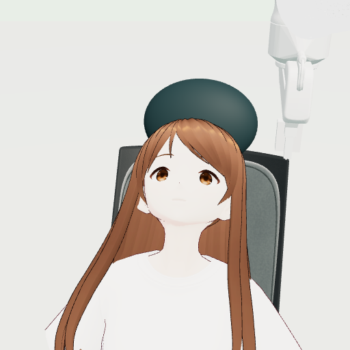

# 画像入力による点眼ロボット

**日本語** | [English](README.en.md)

カメラ画像を見ながら、市販型の目薬容器をロボットアームで操作する課題に取り組みました。目薬を自分で差しにくい人への支援を想定し、人物・ロボット・容器・滴を**シミュレータ内**に用意しています。

固定手順による点眼動作を作成し、その実演を使って既存のロボットAIを追加学習しました。実機や人体を使った検証は行っていません。



## どんな仕組みか

ロボットは左右のカメラ画像、腕・指の状態、共通の作業指示を受け取り、アームの動きと容器を押す指の幅を出力します。目の正解座標や人物の識別子、容器内の滴の状態は、AIへの入力に使いません。

- **シミュレーション**：PyBullet、Three.js
- **ロボットの学習**：[LeRobot](https://github.com/huggingface/lerobot) と事前学習済みの [SmolVLA](https://huggingface.co/lerobot/smolvla_base)
- **学習データ**：固定手順の成功例12回を記録し、学習用6回・検査用6回に分割
- **タスク**：眼の近くに移動し、開眼を待ち、容器を押して1滴を落とし、指を開いて退避する

容器はアームに固定し、押圧と滴下は簡略化したモデルで表現しています。

## 実験結果

開発に使った2体の人物モデルについて、それぞれ1回ずつ、固定手順、AIの追加学習前、追加学習後を比較しました。

| 方法 | 人物モデルA | 人物モデルB |
| --- | --- | --- |
| 固定手順による教師 | 1滴を落とし、解除・退避 | 1滴を落とし、解除・退避 |
| AI：追加学習前 | 滴下に至らず | 滴下に至らず |
| AI：追加学習後 | 指幅の範囲外指令を検出し、開始0.25秒で停止 | 60秒のシミュレーション内で押圧が続かず、滴下なし |

今回の追加学習前には、公開モデルから以前に600回更新した重みを使いました。追加学習後は、そこから今回の実演でさらに3,000回更新した重みです。各条件1回ずつの結果であり、一般的な成功率や初見人物への性能は示していません。

## ファイル構成

| パス | 内容 |
| --- | --- |
| `scripts/` | 実演の収集、教材の準備、学習、評価に使用したコード |
| `outputs/runtime/review-sklearn-v1/src/` | 顔認識、物理シミュレーション、制御の実行コード |
| `preview/` | 人物、腕、容器の描画に関するコードと素材 |
| `source-deltas/` | 実験後に画像保存や集計へ加えた変更の記録 |
| [CREDITS.md](CREDITS.md) | 使用した人物・椅子などの素材の出典と利用条件 |
| [SOURCE_PROVENANCE.md](SOURCE_PROVENANCE.md) | 保存ソースと補完したコードの照合状況 |

人物モデルAはpixivのVRM1_Constraint_Twist_Sample、BはSeed-san、学習に使ったもう1体のCはGodetteです。ソースや記録に残る`original`は人物Aの内部識別子です。

## 実行環境と確認方法

実験にはApple Silicon搭載Mac、Python 3.12、PyTorch 2.11、LeRobot 0.6.1、PyBullet 3.2.7、scikit-learn 1.8.0などを使用しました。

このリポジトリには**実演データ、位置認識器、追加学習前後の重み、乱数状態が含まれていません**。そのため、掲載内容だけで点眼実験の結果を再現できることは確認できていません。データと重みの公開条件や配布方法も未確認です。公開モデル`smolvla_base`だけでは、比較元として使った600回更新済みの重みにはなりません。

Macの既存環境では、収集・学習・評価に関する主要なPythonモジュールの読み込みを確認しました。描画側の一部の単体テストは次のコマンドで実行できます。

```sh
cd preview
npm ci --ignore-scripts
node --test anatomy-contact.test.mjs anatomy-score.test.mjs learning-conditions.test.mjs
```

上記の確認は13件の単体テストであり、点眼の一連の動作や、別の環境での再現を保証するものではありません。

## 今後の課題

AIが指幅を安定して保ち、開眼の待機から押圧、解除、退避までを連続して行えるようにする必要があります。人物が変わった場合の性能、実際の容器や液体、実時間での動作も未評価です。

人物モデルなどの出典と利用条件は[CREDITS.md](CREDITS.md)を参照してください。
